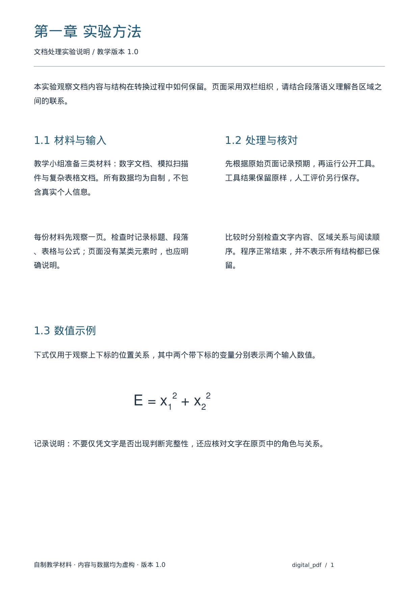
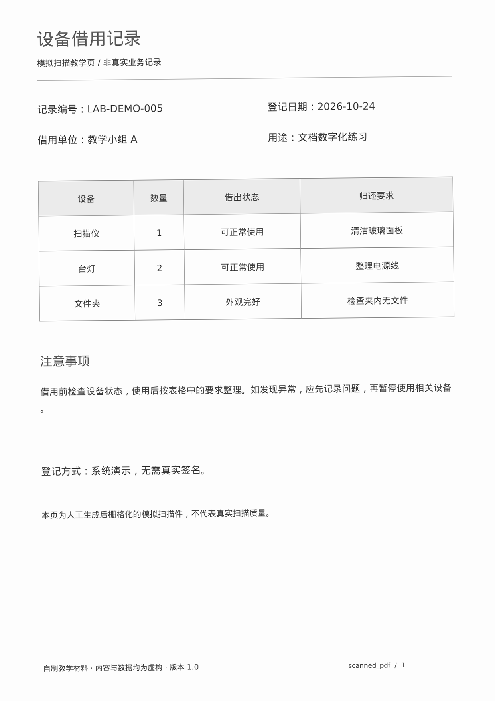

# 第六周剩余内容：一次集中核验

当前：Q07、Q08已核验；Q09已确认Markdown正文顺序保留但未显示页脚，JSON保留页脚。Q06仅补查第一季度合并范围，其余未核验项集中在下面六条。

本页由Codex整理原始输出供本人阅读，未重跑解析、未改写原始导出，也不预填本人的判断。当前三份教学样例不是完整Benchmark。

## 一次回复六项

| 编号 | 检查项 | 本人需要回答 |
| --- | --- | --- |
| 1 | Q01 标题 | 数字页四个标题的文字是否齐全？第一章与1.1/1.2/1.3是否表达为不同标题层级？Markdown的#数量表示标题级别，可直接检查下面源文本。 |
| 2 | Q02 段落 | 1.1和1.2是否各保留两段正文？以空行分隔的段落和原页语义为依据，不按折行数量判断。 |
| 3 | Q03 阅读顺序 | 原页预期依次读1.1、1.2、1.3；实际Markdown的顺序是什么，是否正确？ |
| 4 | Q10 公式（额外观察） | 原页公式E=x_1^2+x_2^2在Markdown中是否成为可读公式？结合下列JSON文字片段，上下标关系是否被明确表达？本轮公式增强关闭，不将观察扩大为工具全面不支持。 |
| 5 | Q04/Q05 扫描件 | 编号、日期是否与原页一致？表格含表头是否4行4列？扫描仪是否对应数量1、归还要求“清洁玻璃面板”？ |
| 6 | Q06 合并范围收尾 | 打开[表格JSON阅读副本](table-structure-view.json)，找到“第一季度”：跨几列，属于横向还是纵向合并？结合已确认的第二季度与类别完成本项检查。 |

可用“1. 文字齐全，层级……；2. ……；……”一次回复。发现错误如实写，不要求结果全部正确。

## 数字PDF：原页与未改写的输出



原始Markdown：

```markdown
## 第一章 实验方法

文档处理实验说明 / 教学版本 1.0

本实验观察文档内容与结构在转换过程中如何保留。页面采用双栏组织，请结合段落语义理解各区域之 间的联系。

## 1.1 材料与输入

教学小组准备三类材料：数字文档、模拟扫描 件与复杂表格文档。所有数据均为自制，不包 含真实个人信息。

每份材料先观察一页。检查时记录标题、段落 、表格与公式；页面没有某类元素时，也应明 确说明。

## 1.3 数值示例

下式仅用于观察上下标的位置关系，其中两个带下标的变量分别表示两个输入数值。

<!-- image -->

记录说明：不要仅凭文字是否出现判断完整性，还应核对文字在原页中的角色与关系。

## 1.2 处理与核对

先根据原始页面记录预期，再运行公开工具。 工具结果保留原样，人工评价另行保存。

比较时分别检查文字内容、区域关系与阅读顺 序。程序正常结束，并不表示所有结构都已保 留。
```

JSON中的公式文字片段（仅解码与摘录，原始文件不变）：

```json
[
  {
    "source_path": "texts[8]",
    "label": "text",
    "text": "E = x 1"
  },
  {
    "source_path": "texts[9]",
    "label": "text",
    "text": "2 + x 2"
  },
  {
    "source_path": "texts[10]",
    "label": "text",
    "text": "2"
  }
]
```

来源：[原始Markdown](../runs/baseline-20261105T152012-076969/digital_pdf/document.md)、[原始JSON](../runs/baseline-20261105T152012-076969/digital_pdf/document.json)。

## 扫描件：原页与未改写的输出



```markdown
## 设备借用记录

模拟扫描教学页/非真实业务记录

记录编号：LAB-DEMO-005

借用单位：教学小组 A

登记日期：2026-10-24

用途：文档数字化练习

| 设备   |   数量 | 借出状态   | 归还要求    |
|------|------|--------|---------|
| 扫描仪  |    1 | 可正常使用  | 清洁玻璃面板  |
| 台灯   |    2 | 可正常使用  | 整理电源线   |
| 文件夹  |    3 | 外观完好   | 检查夹内无文件 |

## 注意事项

借用前检查设备状态，使用后按表格中的要求整理。如发现异常，应先记录问题，再暂停使用相关设备

登记方式：系统演示，无需真实签名。

本页为人工生成后栅格化的模拟扫描件，不代表真实扫描质量。
```

来源：[原始Markdown](../runs/baseline-20261105T152012-076969/scanned_pdf/document.md)、[原始JSON](../runs/baseline-20261105T152012-076969/scanned_pdf/document.json)。

## 自主探索建议：表示

为避免重复下载和运行，建议选择课程的“表示”方向，用现有原始输出比较Markdown和JSON对表格、页脚及公式的保留。这是建议，尚未记作本人已选择或完成。

若本人选择该方向，可在六项回复末尾附“选择表示方向”，再用一两句话说明目前最有证据的一处Markdown/JSON差异及其对使用结果的影响。已核验的页脚例子可以使用；不必增加新模型实验或研究代码细节。Codex据本人反馈统一整理报告、限制、AI披露及学习记录。
