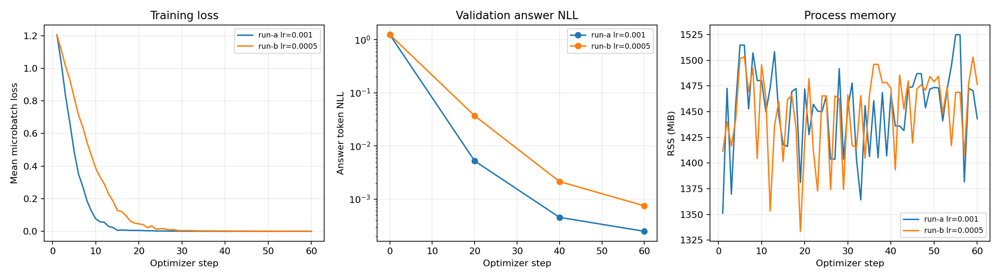
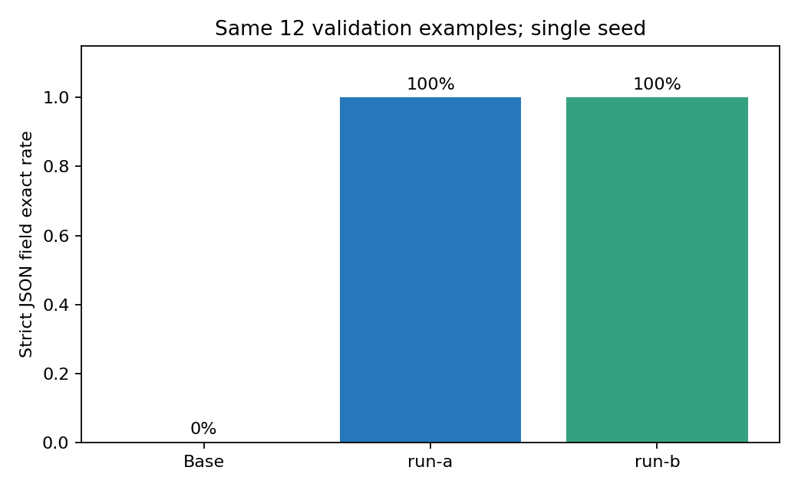

# Week09｜W&B 实验追踪报告 / 云端 Report 正文草稿

状态：真实CPU训练及W&B离线SDK记录完成；**尚未同步到云端，也未创建W&B网页Report**。本文件可作为网页Report正文草稿，不能替代云端Report链接。云端project计划名为 `multimodal-ai-bootcamp-week09`；entity、artifact `:vN` 和Report URL待本人登录后生成，见[收尾清单](manual-review.md)。

## 问题、协议与证据

如何把配置、训练过程、数据与adapter、结论连接起来？本轮接入Week08原训练入口后，从头运行A/B；不是把旧结果事后伪装成实时追踪。唯一算法变量为学习率，name仅是标签。沿用96条train和12条validation、seed42、固定SmolLM2-135M revision、LoRA r8/alpha16、60步、相同Prompt与greedy生成。训练前baseline先落盘；始终未读取reserved-test的样本内容或Week07测试页进行训练。

运行前约定见[计划](../experiment-plan.md)。脚本原始Git commit记录在每个metadata.json，同时保存train.py、tracking.py与数据freeze快照及SHA256。其他周已有未提交改动保留；W&B禁用自动Git捕获，通过明确文件清单追踪本次源码与产物。

## 实测结果

| Run | W&B离线ID | 学习率 | validation exact | 训练后答案NLL | 训练秒数 | 进程峰值MiB |
| --- | --- | --- | --- | --- | --- | --- |
| run-a | `3xryklnu` | 0.001 | 0% → 100% | 0.0002479 | 197.2 | 1570.3 |
| run-b | `0h6gfu6a` | 0.0005 | 0% → 100% | 0.0007466 | 275.4 | 1584.2 |

loss是微批次均值，NLL是参考答案token加权负对数似然；两者数值不可直接等同。exact对JSON解析后的对象与参考答案严格比较，空格/键顺序不影响结果，字段遗漏或额外字段算失败。每条validation影响8.33个百分点。

事实：本轮验证结果见上表；base生成失败，训练后曲线与任务结果共同保留。解释：该小型合成任务中adapter学到了输出结构和字段抽取。限制：12条同分布验证数据、单seed，没有统计显著性或真实文档泛化证据；NLL更低不等于任务效果更好，单次训练速度也不能证明学习率更优。没有部署模型或依据reserved-test调参。

## 失败、异常与恢复

首次SDK启动因沙箱禁止本机socket失败，目录无有效W&B run ID，failure.json及非零退出保留。随后获准在沙箱外运行，保持离线模式。首次完整A训练虽完成，但本地summary导出因SDK SummarySubDict无法直接JSON序列化而失败，调度退出1；原始metadata中的complete仅表示训练完成，不代表追踪成功。该run不纳入成功A/B对照，原样保留，并通过只导出普通标量字典修复后重新运行。额外failure-drill在第2个训练step主动抛RuntimeError，属于预先设计的恢复演练，不是自然训练不稳定，也不参与A/B比较。对应原生W&B退出码、failed summary和日志由[核验结果](../evidence/verification.json)证明。恢复方式为创建新run，保留失败目录。

负面结果包括base的12条非JSON输出；成功A/B也保留全部原始预测，未只挑成功样本。训练集是自制虚构账单，不含真实隐私，许可说明继承Week08 dataset card，基础模型Apache-2.0。该任务可用规则实现，LoRA主要用于学习流程。

## 从结论回查产物

- [run-a 原始证据](../../week09/runs/run-a-20261111T074420Z/comparison.json)，[配置](../../week09/runs/run-a-20261111T074420Z/config.json)，[artifact清单](../../week09/runs/run-a-20261111T074420Z/artifact-manifest.json)。
- [run-b 原始证据](../../week09/runs/run-b-20261111T074903Z/comparison.json)，[配置](../../week09/runs/run-b-20261111T074903Z/config.json)，[artifact清单](../../week09/runs/run-b-20261111T074903Z/artifact-manifest.json)。
- [原始运行入口、日志及退出码](../evidence/)、[总体对比JSON](comparison.json)、[核验脚本](../scripts/verify.py)。
- 每个run保留config、training.jsonl、逐条预测、history.jsonl、metadata、W&B身份及artifact-manifest。dataset/code/evaluation/model均调用真实SDK log_artifact；离线清单给出artifact digest与每文件SHA256，云端版本号待同步后生成。dataset在此通过metadata标注input角色；未声称已建立云端use_artifact消费边。
- W&B原生`.wandb`与缓存留在本机并被Git忽略；本仓库保存可审查的JSON导出与小adapter。新clone需重新运行生成新ID与spool才能同步；当前VM直接同步即可，无需重训。同步前不要清理缓存或spool。

## 模型选择与下一步

暂不选择生产模型：本轮A/B strict exact同分，没有足够证据宣布胜者；优先保留协议和两组产物。下一步先完成云端同步和人工抽查，再在Week10设计独立测试、多seed与错误分析。Week07是PDF解析任务，Week08–09是文本字段抽取，不能用本实验adapter直接与Docling跨任务比较，应先对齐任务与评测协议。

AI使用披露：Codex编写追踪、执行训练、核验与报告；本人尚需登录、检查图表与预测、核对W&B artifact版本、发布Report并填写实际学习时间。没有将AI代执行记为本人已学习或人工核验。
