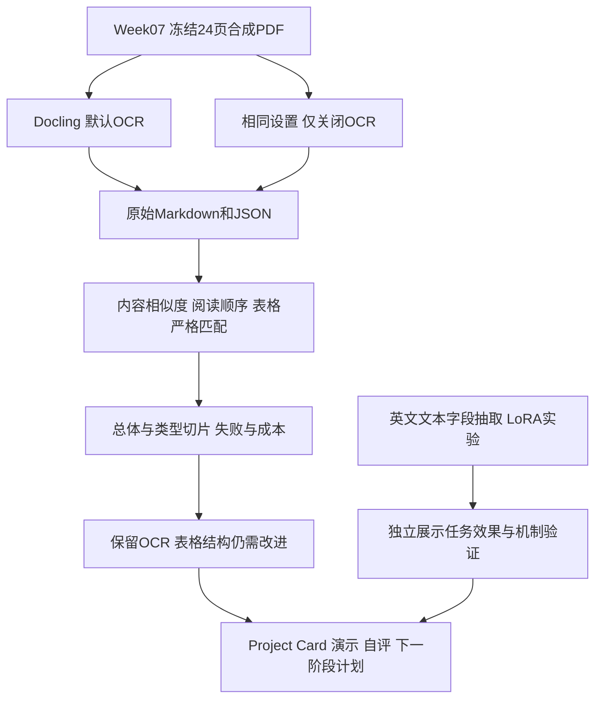

# Week12｜Capstone、展示与自主答辩

本周把已有的实验组织成一个能理解、能重算、能追溯的作品。主问题是：**混合类型PDF是否应默认保留OCR？文字内容分数能否代表结构正确？**

从仓库根目录运行唯一开始入口：

```bash
python3 week12/run.py
```

作用：核对冻结证据与原始输出，调用Week10/11独立核验，重新计算24页PDF的OCR对照与12条文本测试，检查发布文件及本周文档链接，打印结果表。只需Python 3.10或更新版本及标准库；不安装依赖，不下载模型，不训练。执行记录在[execution.json](evidence/execution.json)，两个独立核验日志在[evidence](evidence/README.md)。错误时退出2并保存原因，成功退出0。

## 先理解整体逻辑



PDF负责“页面变成结构化内容”，英文LoRA负责“已有英文文本变成字段JSON”。它们尚未串成端到端系统。两个任务分别评测，不能把英文adapter分数当成PDF识别效果。

## 学习与展示顺序

| 顺序 | 文件 | 只需理解什么 |
| --- | --- | --- |
| 1 | [设计卡](capstone-design.md) | 问题、baseline、唯一变量、指标和停止条件 |
| 2 | [最终报告](reports/final-report.md)、[重算表](reports/results.md) | 数字支持什么决定，哪些失败不能忽略 |
| 3 | [Project Card](project-card.md) | 用途、来源、版本、不适用场景与风险 |
| 4 | [五分钟演示](reports/demo.md)、[答辩问答](reports/defense.md) | 依照证据解释项目，无需逐行解释源码 |
| 5 | [最终自查](reports/self-assessment.md) | AI完成的工作与本人尚待核验的项目 |
| 6 | [未来四周](reports/next-four-weeks.md)、[本人收尾](reports/manual-review.md) | 下一阶段可检查的任务与最终个人操作 |

`run.py`的作用是“认证→重算→对照→记录”，其中PDF评分复用Week07/10，LoRA检查复用Week11。`configs/capstone.json`固定本周展示任务，`evidence/manifest.json`记录静态交付物和来源SHA256；哈希防止归档后悄悄改动，不能证明研究结论正确。

## Ubuntu虚拟机 + VS Code Remote SSH

所有命令在VS Code连接的**Ubuntu远端终端**执行；Markdown用Ctrl+Shift+V预览。此演示不需要本机浏览器服务或端口转发。

```bash
cd ~/multimodal-ai-bootcamp
python3 week12/run.py
```

作用：进入仓库，然后复现归档评分。已在当前VM和隔离的新clone中验证；详情见[复现记录](evidence/reproduction-check.json)。这证明离线归档评分可重算，模型环境从空VM安装、再次训练/推理及陌生同学复现仍是不同层次的检查。

从GitHub单独取得本周成果时，在另一个工作目录执行：

```bash
git clone --branch codex/week12-capstone --single-branch https://github.com/yaxiaodang/multimodal-ai-bootcamp.git multimodal-ai-capstone
cd multimodal-ai-capstone
python3 week12/run.py
```

作用：第一条下载本周分支及其累计历史；第二条进入新目录；第三条离线重算结果。首次clone需要网络，之后重算不需网络。目录若已存在，请使用新的目录名。

```bash
python3 week12/run.py --package
```

作用：先核验，再把已提交HEAD导出到`week12/dist/capstone.tar.gz`。要求发布清单文件和HEAD内容相同，避免检查新文件却打包旧版本。当前工作目录有早期周次未提交修改时，请在干净clone中打包，入口会拒绝工作文件与提交不一致的情况。压缩包包含累计实验、小adapter与原始结果；不包含Git历史、未提交文件、虚拟环境、密钥或模型缓存。输出SHA256和大小写入execution.json；dist被Git忽略。解压后在包根目录执行相同开始命令即可重算。每次执行会更新运行回执，因此生成个人回执后若要再次打包，先保存相应Git提交；日常阅读无需打包。

如要重新执行模型，而不是重算归档：按[Week06环境](../week06/README.md)准备Docling固定模型，按[Week08环境](../week08/README.md)准备CPU文本模型；模型与依赖revision均已记录。之后参考[Week10入口](../week10/README.md)重新做PDF/文本推理、[Week11入口](../week11/README.md)重新训练与机制检查。它们会创建新运行、更新各周派生报告；应在独立工作目录执行并保存旧结果。本周不要求为了展示重复昂贵训练，也未宣称从空VM完整模型复现。

## 交付范围与来源

课程主线材料已整理；[AI披露](evidence/ai-usage.md)与[收尾清单](reports/manual-review.md)明确区分自动核验、本人理解和同学复现。学习记录按[官方模板](https://multimodal-vision-ai.github.io/multimodal-document-ai-learning-center/learning/11_Learning_Log_Template/)追加到[根记录](../learning-log.md)，此前各周保留。

本周依据[Week12要求](https://multimodal-vision-ai.github.io/multimodal-document-ai-learning-center/learning/00_12_Week_Bootcamp/#week-12)和[自主评估指南](https://multimodal-vision-ai.github.io/multimodal-document-ai-learning-center/learning/10_Assessment_and_Submission/)。课程“Capstone设计与展厅发布指南”链接目前进入通用项目展示页，未把它当成额外的正式模板；设计卡按课程列出的字段完成。没有自动向展厅提交或发布网页。
